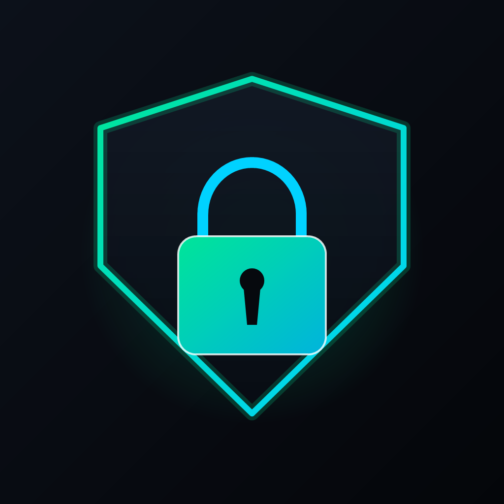

# Arch Technologies 🛡️
### Official Company Profile & Developer Manifesto

  

  <b>Sovereign Mobile Architecture • Zero-Knowledge Security • Air-Gapped Systems</b>

---

## 🏢 Company Overview

**Arch Technologies** is an independent cryptographic engineering and mobile security studio founded by **Anil Suthar**. We engineer uncompromising, air-gapped security utilities for iOS, iPadOS, and macOS. 

In an era of mass surveillance, aggressive cloud telemetry, and mandatory synchronization, Arch Technologies exists to defend **absolute digital sovereignty**. We build applications with zero server backdoors, zero telemetry libraries, zero automated cloud backups, and zero third-party tracking.

---

## 👨‍💻 Lead Developer Profile

* **Name**: Anil Suthar
* **Title**: Lead iOS Systems Architect & Cryptographic Engineer
* **GitHub**: [@mrsutharanil-arch](https://github.com/mrsutharanil-arch)
* **Organization**: Arch Technologies
* **Focus Areas**: 
  - Apple CryptoKit & Secure Enclave Hardware Integration
  - Hardware Data Protection (`FileProtectionType.complete`)
  - Air-Gapped Local-First Architecture
  - Forensic Multi-Pass Memory & Flash Destruction

---

## 🏛️ Core Engineering Principles

### 1. The Owner-Only Doctrine
Every byte of data stored within our applications is anchored to the physical hardware device and unlocked strictly through biometric authentication (`LocalAuthentication`) and hardware-bound Master PINs. We do not provide master passwords or recovery servers—**only the physical device owner holds the cryptographic keys.**

### 2. Zero-Backup Guarantee
By default, mobile operating systems automatically package application directories into iCloud or unencrypted desktop backups. Arch Technologies enforces `NSURLIsExcludedFromBackupKey = true` across all storage trees, preventing files from ever entering transit to third-party servers.

### 3. File Manager & Photo Isolation
Confidential documents and photos should never surface in public file explorers or camera roll albums. We implement strict sandbox containment (`UIFileSharingEnabled = false` and `LSSupportsOpeningDocumentsInPlace = false`) and direct sensor-to-RAM capture pipelines that bypass system photo libraries entirely.

### 4. RAM-Only Decryption & Forensic Shredding
Decrypted cleartext is volatile and exists strictly in memory buffers while actively presented to the owner. The moment a document is closed or the device is locked, all buffers are zeroized (`secureWipe()`). Deleted files are subjected to multi-pass physical overwriting before inode unlinking.

---

## 🛠️ Flagship Application: ZeroVault

**ZeroVault** is our sovereign iOS file fortress:
* **Cipher**: Hardware-accelerated AES-256-GCM with 96-bit nonces.
* **Key Storage**: Bound to device Secure Enclave with `kSecAttrAccessibleAfterFirstUnlockThisDeviceOnly`.
* **Platform**: iOS 16.0+ (SwiftUI & Swift 5.9).
* **Repository**: [https://github.com/mrsutharanil-arch/ZeroVault](https://github.com/mrsutharanil-arch/ZeroVault)

---

## 📬 Contact & Inquiries

* **Developer GitHub**: [mrsutharanil-arch](https://github.com/mrsutharanil-arch)
* **Project Issues & Audits**: [ZeroVault Issues](https://github.com/mrsutharanil-arch/ZeroVault/issues)
* **Location**: Sovereign Developer Ecosystem

---
*© 2026 Arch Technologies & Anil Suthar. All rights reserved.*
